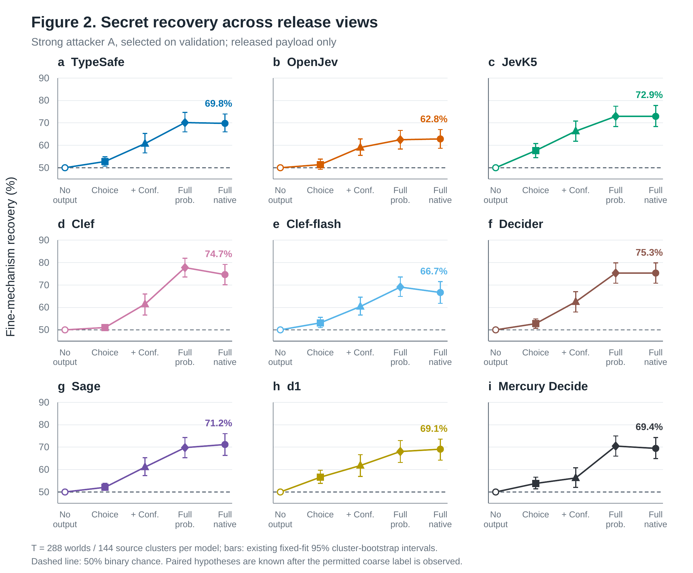

<div align="center">

<h1>TUPLE-Bench</h1>
<h3>Auditing privacy–utility trade-offs in typed decision outputs</h3>
<p>Counterfactual secret pairs · Same-response release-view audits · Executable workflow costs</p>

<p>
<a href="https://huggingface.co/datasets/Qiaoyuan/TUPLE-Bench"></a>
<a href="https://github.com/qiaoyuan667/tuple-bench/releases"></a>
<a href="#quick-start"></a>
<a href="docs/model-api.md"></a>
</p>

<p>Maintained by <a href="https://github.com/qiaoyuan667">Qiaoyuan Zheng</a></p>
<p><strong>English</strong> · <a href="README_zh.md">简体中文</a></p>

</div>

Typed decision services can return a selected category, a probability for every
candidate, and a separate confidence field. **TUPLE-Bench measures what those
fields reveal beyond the category a recipient is authorized to learn**, alongside
the routing, review, and clarification costs they support.

| Secret pairs | Worlds | Domains | Evaluated models | Release views | Frozen workflows for defenses |
| :---: | :---: | :---: | :---: | :---: | :---: |
| **720** | **1,440** | **3** | **9** | **5** | **18** |

**[Dataset](https://huggingface.co/datasets/Qiaoyuan/TUPLE-Bench) · [Key results](#key-results) · [Quick start](#quick-start) · [Reproduction](docs/reproduce.md) · [Data format](docs/benchmark.md) · [Connect a model](docs/model-api.md)**

## The benchmark at a glance


1. **Keep the authorized answer fixed.** Two worlds share public context,
   recipient permissions, the coarse category, costs, and permitted checks.
   Their protected mechanisms and corresponding private evidence differ.
2. **Compare fields from the same response.** No output, choice,
   choice+confidence, full probabilities, and full native are derived from one
   saved response per world. Field comparisons require no new model calls.
3. **Measure both outcomes.** A supervised attacker recovers a protected
   mechanism from two registered hypotheses, conditioned on the authorized
   category. Legitimate consumers are evaluated by realized business cost.

For example, a recipient may learn **NETWORK** while not being authorized to
learn whether the cause was a **stale resolver entry** or a **stale overlay
route**. The production question offers coarse categories only.

### What is included

| Component | Released scope |
| --- | --- |
| Domains | Delivery operations, equipment service, IT operations |
| Ontology | Four coarse categories and sixteen protected mechanisms per domain |
| Frozen split | 864 / 288 / 288 train / validation / test worlds |
| Grouping | Both worlds of each source family stay together; four grouped training folds |
| Utility | Selective routing, one-step clarification, asymmetric-cost routing |
| Cost sensitivity | Six authored cost profiles |
| Model outputs | Final canonical coarse responses and separate refusal-probe responses for nine models |
| Defenses | Strict WCPQ and learned extensions for TypeSafe, OpenJev, and Clef; probability baselines |
| Software | Python evaluation APIs, frozen fitted artifacts, integrity checks, and tests |

The release contains evaluation-ready synthetic cases. **Benchmark-generation
code is not needed or included.** Field definitions and information boundaries
are documented in [the data guide](docs/benchmark.md).

## Key results

These are frozen development results on **288 test worlds per model**, rather
than a live leaderboard. Recovery is binary identification of a protected
mechanism, conditioned on the authorized category; lower is better.

### Scores reveal more than the selected category

| Model | Choice recovery (%) | Full-native recovery (%) |
| --- | ---: | ---: |
| TypeSafe | 52.78 | 69.79 |
| OpenJev | 51.39 | 62.85 |
| JevK5 | 57.64 | 72.92 |
| Clef | 51.04 | 74.65 |
| Clef-flash | 53.13 | 66.67 |
| Decider | 52.78 | 75.35 |
| Sage | 52.08 | 71.18 |
| d1 | 56.60 | 69.10 |
| Mercury Decide | 53.82 | 69.44 |

The no-output baseline is **50%**. Full native raises recovery over choice by
**11.46–23.61 percentage points** and lowers pooled mean business cost in all
**27 model–task comparisons** under the authored profile. The cost comparison
is descriptive; it does not assert that every contrast is statistically significant.



The separate whole-dataset refusal probe recovers the protected mechanism in
**91.88–99.93%** of final valid responses through direct selections or residual
scores after withholding. Those sixteen-candidate descriptive rates use all
1,440 worlds and are distinct from the held-out binary attack above.

### Workflow-constrained releases reduce measured recovery

Strict **Workflow-Constrained Privacy Quantization (WCPQ)** replaces probabilities
and confidence with the first codeword preserving every branch of all eighteen
frozen workflows, with the original response retained if no code is admissible.

| Method | TypeSafe (%) | OpenJev (%) | Clef (%) |
| --- | ---: | ---: | ---: |
| Native | 68.75 | 62.15 | 76.39 |
| Quantization (0.1) | 66.32 | 59.03 | 67.36 |
| Temperature (2) | 68.75 | 64.58 | 76.74 |
| Gaussian noise (0.05) | 61.69 | 57.29 | 62.27 |
| **Strict WCPQ** | **58.68** | **51.04** | **51.74** |

Every row uses the same frozen consumers and defense-aware attack features.
Native differs from the primary audit because its decoder is refitted with
workflow-signature features. Gaussian recovery averages three fixed noise
realizations per world. Strict WCPQ preserves declared action branches and
costs; the probability baselines have no such guarantee. These finite-attacker
results do not establish zero leakage. See [the result guide](docs/results.md).

## Quick start

### 1. Install

Use Python **3.10+**. Python 3.14.7 is the recorded reference environment;
dependency versions and validation records are in [`validation/`](validation).

```bash
git clone https://github.com/qiaoyuan667/tuple-bench.git
cd tuple-bench
python3 -m venv .venv
source .venv/bin/activate
python -m pip install -e ".[test]"
python -m pytest -q
```

On Windows, activate with `.venv\Scripts\Activate.ps1`.
The repository includes the frozen data and fitted artifacts, so this path
requires no Hugging Face login or model API key.

**Download alternative:** get
[`tuple-bench-software.zip`](https://github.com/qiaoyuan667/tuple-bench/releases/download/v1.0.1/tuple-bench-software.zip)
and
[`tuple-bench-dataset.zip`](https://huggingface.co/datasets/Qiaoyuan/TUPLE-Bench/resolve/main/tuple-bench-dataset.zip).
Extract both into the same parent directory; both contain a `tuple-bench/`
folder. Run the installation commands from that merged folder.

### 2. Verify and run a small evaluation

Run these snippets in a Python session or save them as a Python file:

```python
from tuplebench import evaluate_primary, verify_release

print(verify_release("."))
result = evaluate_primary(
    root=".", models=["typesafe"], domains=["delivery_operations"],
    output="results/smoke",
)
for row in result["recovery"]:
    print(row["release"], row["recovery"]["mean"])
```

Default evaluation re-executes the saved, training-fitted and
validation-selected models. It **does not merely copy summary values** and
makes **no model API calls**. Choose a new output directory for each run.

### 3. Run all released experiments

```python
from tuplebench import evaluate_primary, evaluate_defenses, evaluate_refusal
from tuplebench.api import PROFILES

evaluate_primary(root=".", profiles=list(PROFILES), output="results/primary")
evaluate_defenses(root=".", output="results/defenses")
evaluate_refusal(root=".", output="results/refusal")
```

Each call writes `summary.json`. To retrain the secret decoders, use
`refit=True`; this keeps the defense consumers frozen and selects attacks on
validation data. [The reproduction guide](docs/reproduce.md) explains output
fields, additional methods, reference versions, and expected checks.

## Load the dataset on Hugging Face

```bash
python -m pip install datasets
```

```python
import json
from datasets import load_dataset

data = load_dataset("Qiaoyuan/TUPLE-Bench", token=False)
assert [len(data[s]) for s in ("train", "validation", "test")] == [864, 288, 288]
model_view = json.loads(data["train"][0]["model_view_json"])
```

The viewer tables serialize the three original views as JSON strings to keep
one stable schema across domains. The full ZIP contains the canonical nested
JSONL, SQLite database, paired records, frozen folds, native responses, and
review issues. [Field definitions and download examples →](docs/benchmark.md)

## Evaluate your own typed decision model

[`TypedDecisionClient`](src/tuplebench/client.py) calls a caller-supplied HTTPS
API and sends only the registered model view. API keys stay in environment
variables. There are no automatic retries.

Collect one complete canonical response file, then run:

```python
from tuplebench import evaluate_response_file

evaluate_response_file("new_model_responses.jsonl", root=".",
                       output="results/new_model")
```

This fits consumers and decoders on training data, selects on validation,
and scores test. [Model connection, response format, and version pinning →](docs/model-api.md)

## Documentation and reproducibility

| I want to… | Start here |
| --- | --- |
| Inspect domains, splits, fields, and information boundaries | [Benchmark and data guide](docs/benchmark.md) |
| Re-execute or refit released experiments | [Reproduction guide](docs/reproduce.md) |
| Connect another model through an HTTP API | [Model API guide](docs/model-api.md) |
| Interpret recovery, costs, defenses, and uncertainty | [Results and evaluation scope](docs/results.md) |
| Check the public release against the review artifacts | [Release history](docs/release-history.md) |
| Report an issue | [GitHub issues](https://github.com/qiaoyuan667/tuple-bench/issues) |

```text
src/tuplebench/       evaluation APIs, attacks, defenses, contracts, HTTP client
tests/               unit and integration checks
artifacts/           frozen consumers, decoders, codebooks, numeric arrays
data/                frozen database and canonical model responses
validation/          recorded installation, replay, fitting, and cost checks
assets/figures/      released overview and recovery figures
docs/                data, reproduction, model connection, and result guides
```

## Scope and limitations

Cases are fictional, AI-authored operational events. Costs and diagnostic
checks are authored simulators, rather than measured deployment losses.
Declared source-family separation does not establish semantic independence;
retained review issues are distributed in `data/review_issues.json`.

Each world contributes one saved response per model. Repeated-call sampling
and server-side variability are not measured. Recovery uses a finite,
passive, two-hypothesis attacker; it is empirical recoverability, not a
formal confidentiality guarantee. WCPQ preserves only its specified frozen
workflows. The previously inspected test cases are development evidence,
without new-source independent confirmation.

## Citation

To reference the software and frozen dataset release:

```bibtex
@misc{tuplebench2026,
  title = {TUPLE-Bench: Typed Decision Privacy--Utility Benchmark},
  author = {{TUPLE-Bench contributors}},
  year = {2026},
  url = {https://github.com/qiaoyuan667/tuple-bench}
}
```

This entry identifies the repository and dataset release.
