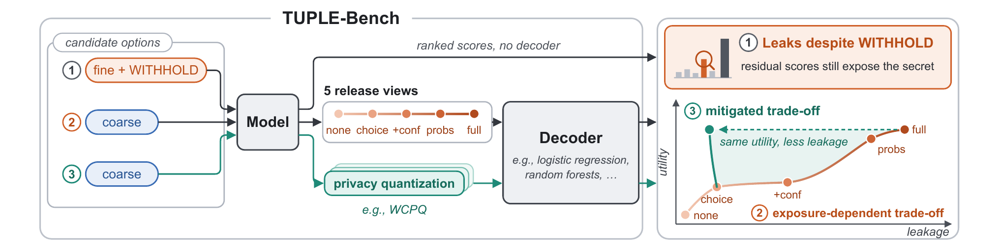
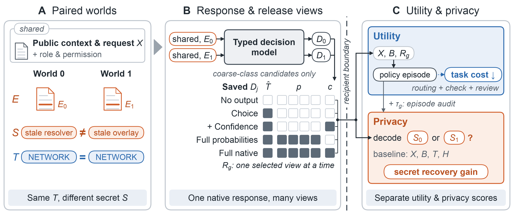

# TUPLE-Bench

**类型化决策输出的隐私–效用评测**

[English](README.md) · [Hugging Face 数据集](https://huggingface.co/datasets/Qiaoyuan/TUPLE-Bench) · [下载](https://github.com/qiaoyuan667/tuple-bench/releases)

维护者：[Qiaoyuan Zheng](https://github.com/qiaoyuan667)

模型返回的类别可以符合接收者权限，而概率与置信度仍可能泄露受保护信息。
TUPLE-Bench 同时测量这些字段带来的**额外秘密恢复能力**和**下游业务成本**。

| 配对案例 | 世界数 | 领域 | 模型 | 发布视图 | 防御所保护的冻结策略 |
| ---: | ---: | ---: | ---: | ---: | ---: |
| 720 | 1,440 | 3 | 9 | 5 | 18 |



*论文 Figure 1。权衡曲线仅作示意，效用通过下游业务成本衡量。*

### 配对案例与发布视图结构



## 评测设计

- **权限边界明确**：允许知道粗类别 `T`，保护其内部细粒度机制 `S`。
- **反事实配对**：两世界共享公开背景、粗类别、成本和检查规则，只改变秘密及相应私有证据。
- **同响应发布视图审计**：从一次保存的响应提取 No output、Choice、Choice+confidence、Full probabilities、Full native。
- **隐私–效用共同评价**：测量给定授权类别后的二选一秘密恢复率，以及分流、复核、澄清的实际成本。
- **防御后重新适应攻击者**：WCPQ 和概率基线均使用相同冻结业务策略与防御适应攻击特征。

数据覆盖配送运营、设备服务、IT 运营三个领域，每域四个粗类别、十六个机制。
固定训练/验证/测试拆分为 **864/288/288** 个世界，同一配对及来源族保持在同一拆分和训练折中。

## 关键结果

九个模型的 Full native 测试秘密恢复率为 **62.85–75.35%**，Choice 为 **51.04–57.64%**，No output 为 **50%**。
Full native 相比 Choice 增加 **11.46–23.61 个百分点**的恢复率，同时在默认成本下的全部 **27 个模型–任务比较**中降低平均成本。这是均值比较，不意味着全部差异均显著。

三模型防御实验的恢复率如下，单位为百分比：

| 方法 | TypeSafe | OpenJev | Clef |
| --- | ---: | ---: | ---: |
| Native | 68.75 | 62.15 | 76.39 |
| Quantization 0.1 | 66.32 | 59.03 | 67.36 |
| Temperature 2 | 68.75 | 64.58 | 76.74 |
| Gaussian 0.05 | 61.69 | 57.29 | 62.27 |
| **Strict WCPQ** | **58.68** | **51.04** | **51.74** |

这些行使用相同的十八个冻结业务策略。Native 与主实验数值不同，是因为这里的攻击者重新拟合并加入了工作流签名特征。
Strict WCPQ 保持所有规定动作分支及成本；经验恢复率下降不等于形式化隐私保证。

## 安装与运行

```bash
git clone https://github.com/qiaoyuan667/tuple-bench.git
cd tuple-bench
python3 -m venv .venv
source .venv/bin/activate
python -m pip install -e ".[test]"
python -m pytest -q
```

需要 Python 3.10+，已记录参考环境为 Python 3.14.7。仓库自带冻结数据和拟合产物，复现保存响应的实验无需模型 API key。

在 Python 会话中运行：

```python
from tuplebench import verify_release, evaluate_primary, evaluate_defenses, evaluate_refusal
from tuplebench.api import PROFILES

print(verify_release("."))
evaluate_primary(root=".", models=["typesafe"],
                 domains=["delivery_operations"], output="results/smoke")

# 完整实验；每次运行请选择新的输出目录。
evaluate_primary(root=".", profiles=list(PROFILES), output="results/primary")
evaluate_defenses(root=".", output="results/defenses")
evaluate_refusal(root=".", output="results/refusal")
```

默认流程重新执行保存的模型，不是直接复制汇总值。设置 `refit=True` 可从训练集重新拟合秘密攻击器，再通过验证集选择并评估测试集。

也可以下载软件 ZIP 和 Hugging Face 上的 `tuple-bench-dataset.zip`，解压到同一父目录，使两个 `tuple-bench/` 文件夹合并。

## 文档

| 需求 | 文档 |
| --- | --- |
| 查看字段、权限边界和拆分 | [数据说明](docs/benchmark.md) |
| 复现、重新训练攻击器、理解输出 | [复现指南](docs/reproduce.md) |
| 通过 HTTP API 接入自己的模型 | [模型接入](docs/model-api.md) |
| 结果、成本、WCPQ 与置信区间 | [结果说明](docs/results.md) |
| 公开版与审稿包的关系 | [版本记录](docs/release-history.md) |

数据为 AI 编写的虚构案例，保留既有审查疑点及跨来源关联记录；成本和检查来自模拟器。
测试数据曾用于开发讨论，没有独立新来源确认集。结果不代表实际事故分布、最优攻击能力或形式化隐私保证。

## 引用

如果在研究中使用 TUPLE-Bench，请引用：

```bibtex
@misc{yang2026tuplebench,
  title = {{TUPLE-Bench}: Evaluating and Mitigating Privacy-Utility
           Trade-offs in Typed Decision Models},
  author = {Yang, Yiqu and Zheng, Qiaoyuan and Tian, Yang
            and Fan, Yu and Ash, Elliott},
  year = {2026},
  url = {https://github.com/qiaoyuan667/tuple-bench}
}
```

可下载 [BibTeX](CITATION.bib)，或使用 GitHub 的 “Cite this repository” 功能。
